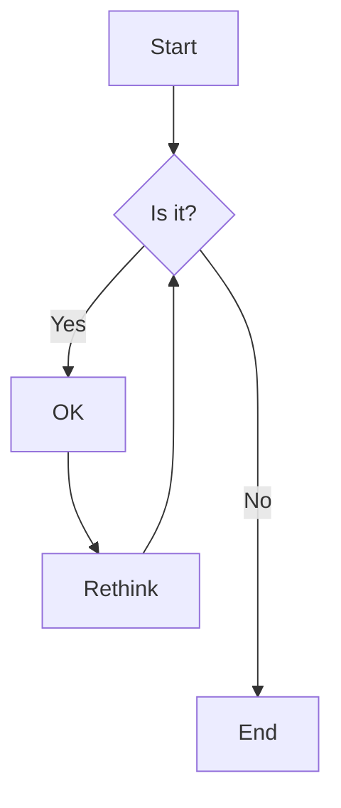
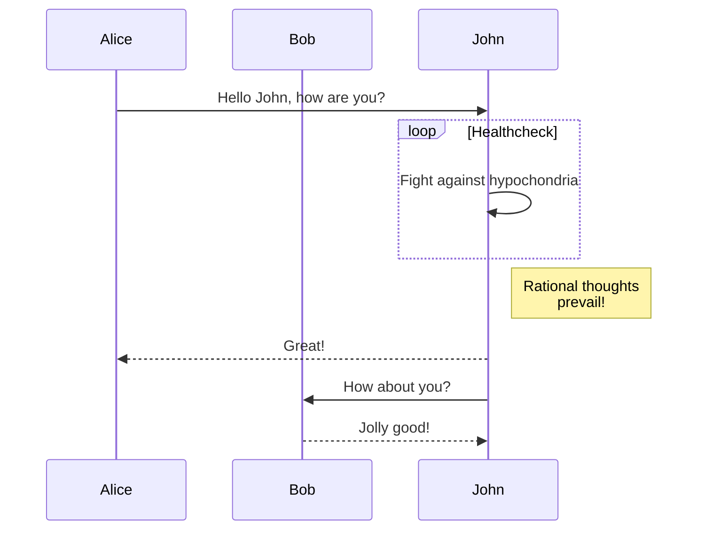
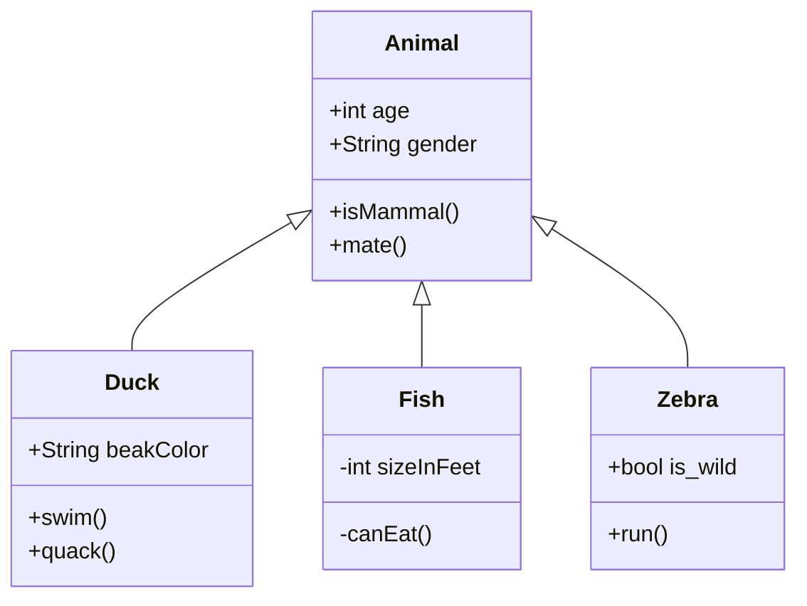
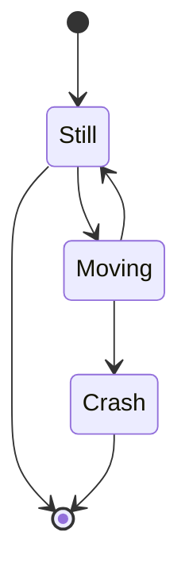
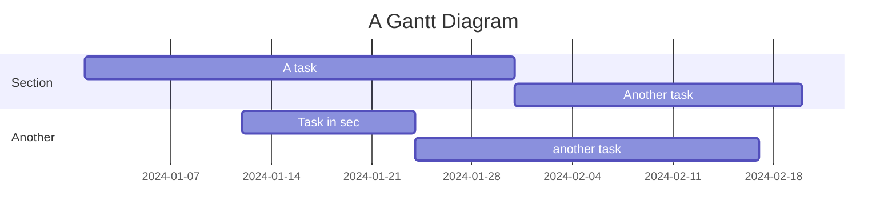

# Mermaid Diagram Examples

This is a sample markdown file with Mermaid diagrams.

## Flowchart Example

## Sequence Diagram

## Class Diagram

## State Diagram

## Gantt Chart

You can **pan** by dragging the diagram and **zoom** using the mouse wheel!
